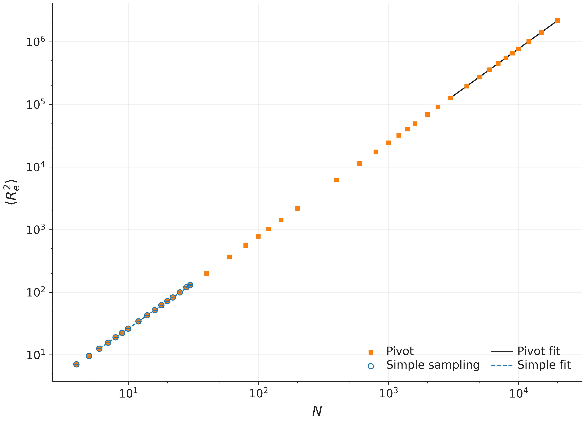
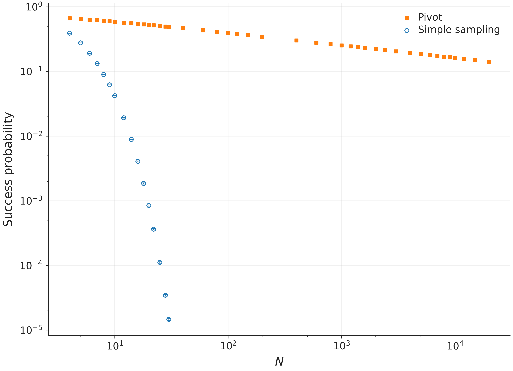
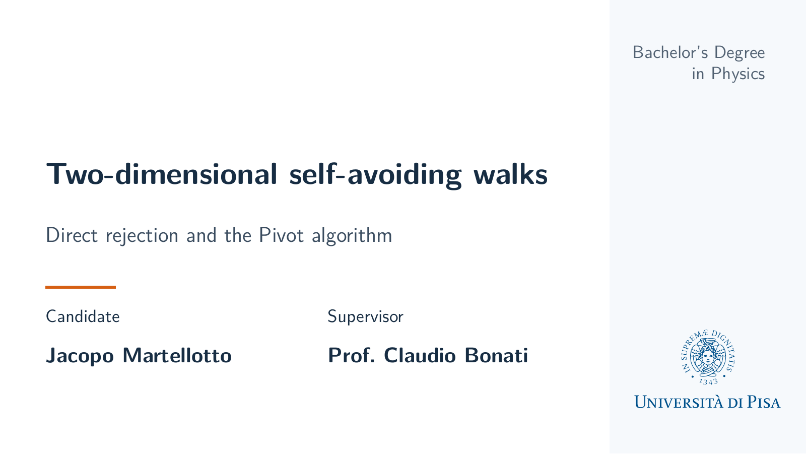
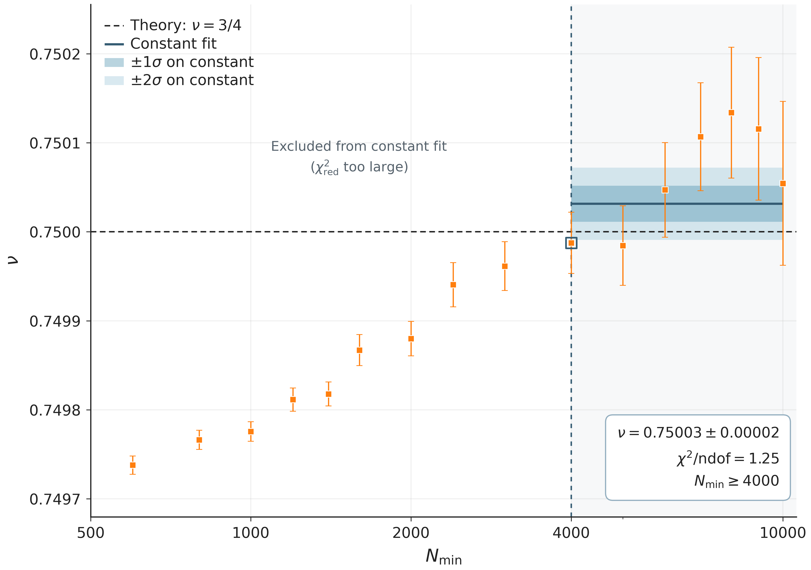
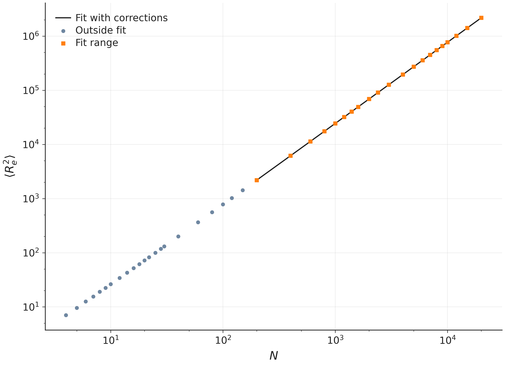

# Two-dimensional self-avoiding walks

### Direct rejection and the Pivot algorithm

A computational study of excluded volume, polymer extension and sampling on the
square lattice. This repository contains the simulation code, saved measurements,
statistical analysis and thesis presentation.

**Author:** Jacopo Martellotto  
**Supervisor:** Prof. Claudio Bonati  
**Degree:** Bachelor's Degree in Physics, University of Pisa

[Quick start](#quick-start) · [Mathematical derivation](#physical-model-and-flory-scaling) ·
[Sampling algorithms](#sampling-algorithms) · [Presentation](#presentation) ·
[Repository map](#repository-map) · [References](#references)

<p align="center">
  <a href="slides/figures/01_estensione.png"></a>
  <a href="slides/figures/02_success_probability.png"></a>
</p>

Both methods sample the same end-to-end observable. Their success probabilities
refer to different events: completing a whole trial for Simple sampling and
accepting one proposed shape update for Pivot. Click a figure to inspect it.

## Results

The figures and fit results below are those shown in the thesis presentation.
Both methods are fitted with the pure power law
$\langle R_e^2\rangle=AN^{2\nu}$.

| Pure-power fit | Length range | Fitted exponent, statistical error | Reduced chi-square | Degrees of freedom |
|---|---|---|---|---|
| Pivot | 3,000–20,000 | $\nu=0.74996\pm0.00003$ | 1.48 | 9 |
| Simple sampling | 6–30 | $\nu=0.724\pm0.002$ | 1.53 | 12 |

The Pivot estimate agrees with the two-dimensional theoretical value $\nu=3/4$.
The Simple-sampling estimate is an **effective short-chain exponent**, for which
finite-size effects remain relevant. Quoted errors are one standard deviation.

**Run time:** approximately 5 days and 16 hours.

## Presentation

Click the cover to open the complete slide deck in
[GitHub's PDF viewer](https://docs.github.com/en/repositories/working-with-files/using-files/working-with-non-code-files#rendering-pdf-documents).

<p align="center">
  <a href="slides/tesi_saw.pdf"></a>
</p>

[Open the slides](slides/tesi_saw.pdf) · [Beamer source](slides/tesi_saw.tex) ·
[Long abstract](long_abstract.pdf)

The English deck has twelve pages: a cover, five content slides, references,
a Backup divider, two theoretical derivations, a supplementary fit with
finite-size corrections, and a final slide on future models. It has no slide
numbers or repeated author footer.

Rebuild the same presentation with a LaTeX installation containing Beamer,
TikZ, babel and Latin Modern:

```powershell
.\slides\build.ps1
```

The presentation and this README read their plot images from `slides/figures/`.
LaTeX build auxiliaries stay in the system temporary directory.
If a PDF viewer locks the file, close it before rebuilding.

## Quick start

To reanalyse the saved results, only Python and the packages in
[requirements.txt](requirements.txt) are needed. From PowerShell in this folder:

```powershell
python -m venv .venv
.\.venv\Scripts\python.exe -m pip install -r requirements.txt
.\.venv\Scripts\python.exe -B scripts/render_outputs.py
```

To run the complete simulation pipeline, also install `g++` with C++17 support
and put it on `PATH`. The checked Windows environment uses Python 3.14.0 and g++ 10.3.0.
The Python package versions are pinned in `requirements.txt`.

```powershell
.\run_all.ps1 -Python ".\.venv\Scripts\python.exe"
```

This command performs, in order:

1. independent thermalization pilot runs for every Pivot length;
2. automatic selection and recording of a fixed burn-in for every length;
3. the complete Simple-sampling and Pivot production runs;
4. fits, tables, the six main figures (01, 02, 04, 05, 07, 09), and the backup correction-fit figure.

The main scaling analysis uses only the pure law
`<Re2> = A*N^(2*nu)`. The declared ranges are `N=6–30` for Simple sampling
and `N=3000–20000` for Pivot. This range includes eleven measured lengths;
the cutoff-stability plot documents the sensitivity to the chosen lower bound.

The long Pivot production is intentionally the full thesis workload and is
computationally expensive. Completed replica files are reused, so rerunning the
same command resumes the pipeline. Use `-Overwrite` only to discard that reuse
and recompute every stage. `-Jobs 8` changes parallelism, and `-DryRun` checks
the planned workload without simulating.

## Physical model and Flory scaling

A self-avoiding walk is a sequence of lattice sites
$\omega=(\mathbf r_0,\ldots,\mathbf r_N)$ with nearest-neighbour bonds of
length $a$ and no repeated site. The model keeps excluded volume and omits
attractive interactions between nonconsecutive monomers. All allowed walks
of a given length have equal statistical weight.

| Symbol | Meaning |
|---|---|
| $N$ | Number of bonds, so a completed chain visits $N+1$ sites |
| $a$ | Lattice spacing, set to one in the simulations |
| $d$ | Spatial dimension, equal to two here |
| $\mathbf R_e=\mathbf r_N-\mathbf r_0$ | End-to-end vector of one configuration |
| $R$ | Trial chain size in the Flory free energy |
| $R_*$ | Chain size that minimises the Flory free energy |
| $v>0$ | Effective excluded-volume parameter, with units of length to the power $d$ |
| $\nu_F$ | Flory's estimate of the scaling exponent |
| $\nu$ | Exponent fitted from the measured mean squared end-to-end distance |

The expected long-chain behaviour in two dimensions is

$$
\langle R_e^2\rangle\sim a^2N^{2\nu},\qquad \nu=\frac34.
$$

The argument below explains why Flory theory gives the same exponent. It follows
the scaling picture of [de Gennes](https://cornellpress.cornell.edu/book/9780801412035/scaling-concepts-in-polymer-physics/).
It is a physical approximation, not a rigorous proof for the square-lattice SAW;
see [Lectures on Self-Avoiding Walks](https://www.ihes.fr/~duminil/publi/saw_lecture_notes.pdf)
for the distinction between predictions and rigorous results.

<details>
<summary><strong>Full derivation: entropy, excluded volume and the second moment</strong></summary>

### Entropic elasticity

For an ideal long chain, the Gaussian density of the end-to-end vector is

$$
P_0(\mathbf R)\propto
\exp\!\left(-\frac{dR^2}{2Na^2}\right).
$$

Using $F=-k_BT\log P_0+\mathrm{constant}$ gives a dimensionless stretching cost

$$
\frac{F_{\mathrm{el}}(R)}{k_BT}
\simeq C_{\mathrm{el}}\frac{R^2}{Na^2},
\qquad C_{\mathrm{el}}>0.
$$

Stretching reduces the number of conformations. Flory theory approximates this
contribution by Gaussian elasticity even for the excluded-volume chain.

### Excluded volume

Approximate the chain as occupying a region of volume $V\sim R^d$, with uniform
monomer density $\rho\sim N/R^d$. The leading pair contribution is

$$
\frac{F_{\mathrm{int}}(R)}{k_BT}
\sim\frac v2\int\rho(\mathbf r)^2\,d^d\mathbf r
\sim C_{\mathrm{int}}\frac{vN^2}{R^d},
\qquad C_{\mathrm{int}}>0.
$$

For the hard self-avoiding model this is an effective entropic penalty: crowding
reduces the number of allowed conformations. It does not add a contact energy
to the simulated SAWs. The ratio $vN^2/R^d$ is dimensionless.

### Minimum of the Flory free energy

Adding the two leading terms gives

$$
\Phi(R)\equiv\frac{F_F(R)}{k_BT}
=C_{\mathrm{el}}\frac{R^2}{Na^2}
+C_{\mathrm{int}}\frac{vN^2}{R^d}.
$$

At the minimum,

$$
\Phi'(R_*)=
\frac{2C_{\mathrm{el}}R_*}{Na^2}
-\frac{dC_{\mathrm{int}}vN^2}{R_*^{d+1}}=0,
$$

and therefore

$$
R_*^{d+2}=
\frac{dC_{\mathrm{int}}}{2C_{\mathrm{el}}}\,va^2N^3.
$$

Both terms in the second derivative are positive for $R>0$ and $v>0$:

$$
\Phi''(R)=\frac{2C_{\mathrm{el}}}{Na^2}
+\frac{d(d+1)C_{\mathrm{int}}vN^2}{R^{d+2}}>0.
$$

Ignoring numerical prefactors independent of $N$,

$$
R_*\sim(va^2)^{1/(d+2)}N^{3/(d+2)}.
$$

For fixed positive excluded volume of order $v\sim a^d$,

$$
R_*\sim aN^{\nu_F},\qquad \nu_F=\frac{3}{d+2}.
$$

### From a typical size to the measured second moment

Assume one dominant chain-size scale and write the end-to-end vector density as

$$
P_N(\mathbf R_e)=R_*^{-d}\,\mathcal p(\mathbf R_e/R_*).
$$

Changing variables to $\mathbf x=\mathbf R_e/R_*$ gives

$$
\begin{aligned}
\langle R_e^2\rangle
&=\int\lVert\mathbf R_e\rVert^2P_N(\mathbf R_e)\,d^d\mathbf R_e\\
&=R_*^2\int\lVert\mathbf x\rVert^2\mathcal p(\mathbf x)\,d^d\mathbf x
\sim R_*^2.
\end{aligned}
$$

This step requires a finite, nonzero second moment of the scaling function.
For $d=2$ it leads to

$$
\boxed{\nu_F=\frac34,\qquad
\langle R_e^2\rangle\sim R_*^2\sim a^2N^{3/2}.}
$$

The simulation uses $a=1$. The assumptions are a long chain $N\gg1$, Gaussian
elasticity, uniform density, a leading local pair term, fixed $v\sim a^d>0$
and one dominant size scale. Finite-chain corrections and spatial correlations
are not resolved by this approximation.

</details>

## Sampling algorithms

### Simple sampling by direct rejection

The current Simple sampler generates independent non-backtracking walks.
The first step chooses uniformly among four directions. Each later step chooses
uniformly among the three directions other than the immediate reverse. Other
occupied sites are still proposed and cause rejection of the entire trial.
The algorithm never renormalizes over all unoccupied neighbours.

Every complete N-step proposal has probability `1/(4*3**(N-1))`, so accepted
walks still form a uniform sample of N-step SAWs. Its success probability is
`c_N/(4*3**(N-1))`, where `c_N` counts N-step SAWs from the origin. This differs
from the four-direction sampler's `c_N/4**N`. Pivot success continues to mean
acceptance of one proposed transformation of an existing SAW.

To see why the accepted sample is uniform, let $c_N$ count N-step SAWs. For
each allowed complete walk, the proposal probability is

$$
q_N(\omega)=\frac{1}{4\,3^{N-1}},\qquad
P_{\mathrm{success}}=\frac{c_N}{4\,3^{N-1}}.
$$

Conditioning on acceptance cancels the proposal factor:

$$
P(\omega\mid\mathrm{success})
=\frac{q_N(\omega)}{P_{\mathrm{success}}}=\frac1{c_N}.
$$

The fixed protocol retains 124 million independent trials across all lengths:
one million base trials at each of 16 lengths, plus 108 million refinement trials.
CSV rows and saved refinement moments identify the proposal scheme. Checks on
the scheme, seed, source and protocol prevent pooling or reusing old samples
from the four-direction generator.

To regenerate only Simple sampling, leaving the existing Pivot results in place:

```powershell
.\.venv\Scripts\python.exe -B scripts/run_production.py simple-sampling --overwrite
.\.venv\Scripts\python.exe -B scripts/render_outputs.py
```

### Pivot algorithm and the Markov chain

The [Pivot implementation](src/pivot_saw.cpp) starts from a straight SAW.
At each attempted update it chooses $k$ uniformly from $1,\ldots,N-1$ and
one of the seven nonidentity square-lattice symmetries. The prefix is fixed
and the tail is transformed around the pivot:

$$
\mathbf r_i'=\begin{cases}
\mathbf r_i,&i\leq k,\\
\mathbf r_k+g(\mathbf r_i-\mathbf r_k),&i>k.
\end{cases}
$$

The transformations are rotations by 90, 180 or 270 degrees, and reflections
in the coordinate axes or diagonals. Each preserves bond lengths and internal
tail self-avoidance. The overlap check therefore tests the new tail against
the fixed prefix. A valid proposal is accepted; a collision leaves the old
configuration in place.

The next state depends on the current walk and a fresh random proposal, which
makes this a Markov chain. Since inverse transformations occur with the same
probability, the proposal kernel is symmetric. With acceptance
$\alpha(\omega,\omega')=1$ for valid proposals and zero otherwise,

$$
\pi_N(\omega)q(\omega,\omega')\alpha(\omega,\omega')
=\pi_N(\omega')q(\omega',\omega)\alpha(\omega',\omega)
$$

holds for equal weights on the allowed configurations. This is detailed
balance. The code fixes the first bond along the positive x-axis, so the
uniform target is restricted to that orientation sector. End-to-end distance
is invariant under the corresponding global rotations and reflections.
The original algorithm is described by
[Madras and Sokal (1988)](https://doi.org/10.1007/BF01022990).

Production measures after **every attempt, including rejection**. Removing
repeated states after rejected moves would change their statistical weight.
Successive states are correlated even after thermalization.

## Thermalization protocol

Thermalization is calibrated before production and never selected from the
measurements used in the final averages. For every simulated length, eight
independent pilot chains start from the straight configuration. The diagnostic
tracks the squared end-to-end distance, the acceptance indicator, and the
normalized free path.

For each observable, the script compares the relaxation curve with the final
quarter of the pilot trace and finds the first sustained stable region. The
production burn-in is placed after two additional full stability windows and
is never smaller than twice the latest of the three detected onsets. It is then
rounded to the trace spacing. The pipeline stops if this value lies too close
to the end of the pilot, because that would mean the pilot is not long enough
to validate the cutoff.

The production attempt count starts **after** burn-in. Reducing unnecessary
burn-in therefore saves computation without reducing the requested production
sample or its statistical precision. Every chosen cutoff and the complete rule
used to obtain it are stored under `outputs/diagnostics/thermalization`.

For completeness, the implemented safety rule can be written as

$$
B_N=\Delta t\left\lceil
\frac{\max(2t_0,\ t_0+2W)}{\Delta t}
\right\rceil,\qquad W=20\Delta t,
$$

where $t_0$ is the latest detected onset among the three diagnostics and
$\Delta t$ is the pilot recording interval. Detection uses trailing averages,
a late-curve reference and twenty consecutive stable bins, together with a
check on the remaining-tail mean. The tolerance is the larger of three times
the late ensemble-curve standard deviation and an observable-specific floor:
5% of the late mean for $R_e^2$, or 0.02 for acceptance and normalized free path.
This is an operational convergence diagnostic, not a proof of equilibration.
The actual per-length discarded attempt counts are recorded in
[cutoffs.csv](outputs/diagnostics/thermalization/cutoffs.csv).

## Observables and their uncertainties

The common physical observable is

$$
R_e^2=\lVert\mathbf r_N-\mathbf r_0\rVert^2.
$$

Simple sampling measures it on completed accepted walks. Pivot measures it
on production states after the independently calibrated burn-in. Failure is
one minus success, with the different event definitions given above.

The retained free-path diagnostic $L$ counts the valid sites or steps checked
before the first collision, excluding the colliding step. For Simple sampling,
it counts valid growth steps and is normalized by the requested $N$. For Pivot,
it counts transformed tail sites checked from the pivot toward the endpoint,
and is normalized by that proposal's tail length $N-k$:

$$
\left\langle\frac{L}{N}\right\rangle_{\mathrm{simple}},
\qquad
\left\langle\frac{L}{N-k}\right\rangle_{\mathrm{pivot}}.
$$

Accepted trials contribute one to each normalized quantity. These are
algorithm diagnostics with different meanings, not identical polymer
observables. In Pivot the normalization is performed before averaging,
because $k$ changes at each proposal.

<details>
<summary><strong>Error formulas and pooling of the saved sufficient statistics</strong></summary>

For $m$ independent completed Simple-sampling walks, the sample mean and its
estimated standard error are

$$
\bar X=\frac1m\sum_{i=1}^{m}X_i,\qquad
s_X^2=\frac{1}{m-1}\sum_{i=1}^{m}(X_i-\bar X)^2,
\qquad \mathrm{SEM}(\bar X)=\frac{s_X}{\sqrt m}.
$$

For $X=R_e^2$, $m$ is the number of survivors. For $L$ and $L/N$, it is the
total number of independent trials. With $S$ successes in $M$ trials,

$$
\widehat p=\frac SM,\qquad
\widehat{\mathrm{SEM}}(\widehat p)
=\sqrt{\frac{\widehat p(1-\widehat p)}M}.
$$

This is the binomial standard-error estimate, not an exact confidence interval
at the boundaries zero and one. Success and failure have the same SEM.

Base and refinement runs are pooled through their counts and sums, not by
taking an unweighted average of their means. If $S_1=\sum_iX_i$ and
$S_2=\sum_iX_i^2$, then

$$
\bar X=\frac{S_1}{m},\qquad
s_X^2=\frac{S_2-S_1^2/m}{m-1}.
$$

Counts and sums add across independent batches. The proposal-scheme and seed
checks prevent combining incompatible data.

For Pivot, let $\bar X_j$ be the production mean from independent replica $j$.
The reported result and SEM are

$$
\bar X=\frac1K\sum_{j=1}^{K}\bar X_j,\qquad
\widehat{\mathrm{SEM}}(\bar X)
=\sqrt{\frac{\sum_{j=1}^{K}(\bar X_j-\bar X)^2}{K(K-1)}}.
$$

This uses the dispersion of independent replica means rather than treating
consecutive Markov-chain states as independent. At each fixed $N$, production
replicas have equal attempt counts. There are 16 replicas for each short or
intermediate length and 80 for each long length. Their precise workload and
seeds are defined in [simulation_protocol.json](config/simulation_protocol.json).

</details>

## Power-law fits and statistical errors

`scripts/estimate_nu.py` fits the original mean squared end-to-end distance
with `A*N**(2*nu)` using `scipy.optimize.curve_fit`, `sigma=SEM` and
`absolute_sigma=True`. Both A and nu are fitted. Standard errors are
`sqrt(diag(pcov))`; the covariance is not rescaled by chi-square per degree
of freedom. Saved 68% and 95% intervals are local Gaussian approximations.
Results include the parameter covariance, chi-square, degrees of freedom
and p-value.

Writing $y_i=\langle R_e^2\rangle_{N_i}$ and using its measured SEM $\sigma_i$,
the fitted model and objective are

$$
f(N;A,\nu)=AN^{2\nu},\qquad
\chi^2(A,\nu)=\sum_{i=1}^{m}
\left[\frac{y_i-AN_i^{2\nu}}{\sigma_i}\right]^2.
$$

The amplitude $A$ sets the overall chain-size scale; $\nu$ determines its
growth with length. Both are estimated in the original observable, without a
logarithmic transformation. With two fitted parameters,

$$
\mathrm{ndof}=m-2,\qquad
\chi^2_{\mathrm{red}}=\frac{\chi^2}{m-2}.
$$

The analytic Jacobian is

$$
\frac{\partial f_i}{\partial A}=N_i^{2\nu},\qquad
\frac{\partial f_i}{\partial\nu}=2AN_i^{2\nu}\log N_i.
$$

Locally, the covariance is approximated by
$C\simeq(J^TWJ)^{-1}$, where $W_{ii}=1/\sigma_i^2$.
The one-sigma parameter errors are $\sqrt{C_{AA}}$ and
$\sqrt{C_{\nu\nu}}$. `absolute_sigma=True` preserves the supplied statistical
error scale: no multiplication by the reduced chi-square is applied.

Final fit ranges come from `config/simulation_protocol.json`: currently
Pivot N >= 3000 and simple sampling N >= 6. The latter estimates an effective
short-chain exponent. Increased Simple-sampling precision can expose finite-size
deviations from the pure power law, increasing chi-square even when the observable
is sampled correctly. The declared fit range and statistical errors are not
adjusted to make chi-square smaller. A large reduced chi-square means that the
pure-law result cannot be treated as a validated asymptotic exponent estimate.
The stability scan repeats the fit for each measured
cutoff from 200 to 10000, retaining at least four lengths. Low-cutoff fits
with large chi-square diagnose failure of the pure-power model and are not
used as the final Pivot estimate. Scan points share data and are correlated.
The stability figure retains all displayed points and one-sigma bars, without
interpolation. A descriptive constant fit uses curve_fit with sigma=nu_sem and
absolute_sigma=True. It tries the last 9, 8, ... cutoff estimates, stopping at
the first reduced chi-square <=1.5 (at least 3 points). The current selection
uses 7 estimates from N_min=4000; the full sequence is recorded in
`outputs/analysis/nu_constant_region.json`. The plot shades this selected range.
The colored one- and two-sigma bands show the nominal uncertainty of the fitted
constant within the selected range, not the spread of cutoff estimates.
Correlations between scan estimates are ignored in this requested diagonal fit;
its nominal uncertainty and chi-square do not constitute a calibrated plateau
test or account for range selection. The primary power-law cutoff remains 3000.

<details>
<summary><strong>Cutoff-stability plot and the constant fit</strong></summary>



Each plotted point is a separate power-law fit using all measured lengths
$N\geq N_{\min}$. It is not a simulated exponent at a single length. At least
four lengths are retained per fit, so the largest plotted cutoff is 10,000
even though the underlying walks reach 20,000 steps. The displayed scan starts
at 500; the first available cutoff there is 600. The CSV retains the complete
scan from 200 onward.

For a chosen set of exponent estimates $\nu_i$ with nominal errors $s_i$,
the diagonal constant fit minimises

$$
\chi^2(c)=\sum_i\frac{(\nu_i-c)^2}{s_i^2},\qquad
\widehat c=\frac{\sum_i\nu_i/s_i^2}{\sum_i1/s_i^2},\qquad
s_c=\left(\sum_i1/s_i^2\right)^{-1/2}.
$$

The fit has one parameter and $m-1$ degrees of freedom. The shaded parameter
bands are $\widehat c\pm s_c$ and $\widehat c\pm2s_c$ within the selected
range. They are nominal intervals conditional on that range and the diagonal
approximation. Shared-data correlations between points are not included.

The saved selection is $N_{\min}\geq4000$, with
$c=0.75003\pm0.00002$ and reduced chi-square 1.25. The full sequence of tested
ranges is recorded in
[nu_constant_region.json](outputs/analysis/nu_constant_region.json).

</details>

The supplementary backup fit uses `A*N^(2*nu)*(1+b/N+c/N^1.5)` with four free
parameters on all 21 Pivot lengths from 200 to 20000. `plot_corrected_fit.py`
saves `backup_pivot_corrections.png`, its JSON fit record and the generated
slide macros `slides/pivot_corrected_results.tex`. It does not replace the
primary pure-power-law results. The figure also displays the 22 shorter Pivot
measurements outside the fit. Fit figures have no zoom insets.

The supplementary model is

$$
\langle R_e^2\rangle=AN^{2\nu}
\left(1+\frac bN+\frac c{N^{3/2}}\right).
$$

The correction powers are fixed; $A$, $\nu$, $b$ and $c$ are fitted. It has
17 degrees of freedom for 21 lengths. The motivation for analytic and
nonanalytic finite-size corrections is discussed by
[Caracciolo et al. (2005)](https://arxiv.org/abs/cond-mat/0409355).

<details>
<summary><strong>Finite-size correction fit from the backup slides</strong></summary>



| Quantity | Fit result |
|---|---|
| Length range | $200\leq N\leq20000$; 21 lengths |
| $\nu$ | $0.75005\pm0.00003$ |
| $A$ | $0.7704\pm0.0004$ |
| $b$ | $1.8\pm0.2$ |
| $c$ | $-6\pm2$ |
| Reduced chi-square | 1.02 |
| Degrees of freedom | 17 |

</details>

To recalculate analyses and figures from existing data without new simulations:

```powershell
.\.venv\Scripts\python.exe -B scripts/render_outputs.py
```

## Output map

| Folder | Contents |
|---|---|
| `outputs/data/simple_sampling` | Direct-rejection data and refinement moments |
| `outputs/data/pivot/runs` | Individual independent Pivot replicas, grouped by length |
| `outputs/data/pivot/summary.csv` | Means and between-replica uncertainties for every length |
| `outputs/diagnostics/thermalization` | Pilot traces, plateau estimates, and production cutoffs |
| `outputs/analysis` | Fit results and numerical comparison tables |
| `outputs/figures` | Final high-resolution PNG figures only |
| `slides/figures` | Plot images and fit macros used by the presentation and README |

`run_all.ps1` generates numerical analyses and figures under `outputs/`.
`slides/build.ps1` builds the presentation using the assets in `slides/figures/`.
The retained PNG figures keep their original numbering:

- `01_estensione.png`: end-to-end distance and power-law fits;
- `02_success_probability.png`: success probability;
- `04_comparison_table.png`: measured quantities and SEMs at shared lengths;
- `05_nu_scaling.png`: pure-power scaling fits;
- `07_thermalization.png`: pilot relaxation and actual production cutoffs;
- `09_nu_vs_lmin.png`: Pivot exponent stability versus the minimum fitted length.

No separate autocorrelation diagnostic runs are scheduled. Free-path measurements
remain necessary for the comparison table and thermalization calibration.

## Repository map

| Path | Purpose |
|---|---|
| `config/simulation_protocol.json` | Single source for lengths, statistics, seeds, and calibration rule |
| `src/pivot_saw.cpp` | Pivot simulation |
| `grid/run_simple_sampling.py` | Simple-sampling simulation |
| `scripts/calibrate_thermalization.py` | Independent per-length burn-in calibration |
| `scripts/run_production.py` | Resumable production and replica aggregation |
| `scripts/run_pipeline.py` | Full pipeline orchestrator |
| `scripts/render_outputs.py` | Fits, tables, plots, and output validation |
| `scripts/estimate_nu.py` | Shared power-law fit, covariance errors, and saved exponent estimates |
| `scripts/compare_simple_sampling_pivot.py` | Figures 01, 02, 04 and their numerical comparison table |
| `scripts/plot_nu_scaling.py` | Figure 05: scaling and fitted power laws |
| `scripts/plot_thermalization.py` | Figure 07: relaxation and production burn-in |
| `scripts/plot_nu_vs_lmin.py` | Figure 09: exponent stability over fit cutoffs |
| `scripts/comparison_data.py` | Shared loader for pooled Simple-sampling measurements |
| `scripts/figure_style.py` | Shared figure appearance and PNG export |
| `scripts/project_paths.py` | Shared paths, output directories, and protocol hashing |
| `run_all.ps1` | One-command PowerShell entry point |
| `slides/tesi_saw.tex` | Preserved English Beamer presentation |
| `slides/tesi_saw.pdf` | Presentation ready for projection and GitHub's PDF viewer |
| `slides/build.ps1` | Rebuild the preserved deck without running simulations |
| `long_abstract.pdf` | Thesis long abstract |

Every Python file listed above is used by the pipeline, either as an entry
point or as an imported module. For routine use, run `run_all.ps1` for the full
pipeline or `scripts/render_outputs.py` for analysis and figures only.
Keep `.venv`: it contains the installed Python environment, not temporary
project scripts. The data and thermalization records support reproduction
and resuming completed runs.

Fixed seeds make a completed run reproducible with the same code, protocol,
compiler, and numerical libraries. Run-definition hashes prevent silent reuse
of results produced with a different source or configuration.

`.gitattributes` preserves the exact bytes of the hashed simulation sources and
saved outputs, preventing automatic Git line-ending conversion from invalidating
the recorded source or calibration hashes. Changing source, protocol or numerical
environment can change new Monte Carlo results. The code deliberately refuses
to silently reuse incompatible cached runs.

`.gitignore` keeps the repository focused on the research project. It excludes
the local Python environment, compiled executables, incomplete jobs, LaTeX
auxiliaries, personal university paperwork under `Documents/`, and local PDF
copies of third-party publications under `references/`. The saved measurements,
calibration traces, figures, slide sources, final PDFs and long abstract remain
included. No reference PDF is needed to execute the pipeline.

## Future directions

Natural extensions are three-dimensional SAWs and attractive interactions between
nonconsecutive monomers on neighbouring sites. The latter defines an interacting
self-avoiding walk (ISAW) and would allow solvent quality and swollen-to-compact
behaviour to be studied. These extensions appear in the presentation's outlook
but are not implemented in the current simulation.

## References

1. P.-G. de Gennes, *Scaling Concepts in Polymer Physics*. Cornell University
   Press, Ithaca (1979).
   [Publisher](https://cornellpress.cornell.edu/book/9780801412035/scaling-concepts-in-polymer-physics/).
2. K. Binder and D. W. Heermann, *Monte Carlo Simulation in Statistical Physics:
   An Introduction*, 4th ed. Springer, Berlin (2002).
   [DOI: 10.1007/978-3-662-04685-2](https://doi.org/10.1007/978-3-662-04685-2).
3. N. Madras and A. D. Sokal, “The pivot algorithm: A highly efficient Monte Carlo
   method for the self-avoiding walk”, *Journal of Statistical Physics* **50**,
   109–186 (1988).
   [DOI: 10.1007/BF01022990](https://doi.org/10.1007/BF01022990).
4. S. Caracciolo, A. J. Guttmann, I. Jensen, A. Pelissetto, A. N. Rogers and
   A. D. Sokal, “Correction-to-scaling exponents for two-dimensional self-avoiding
   walks”, *Journal of Statistical Physics* **120**, 1037–1100 (2005).
   [DOI: 10.1007/s10955-005-7004-3](https://doi.org/10.1007/s10955-005-7004-3),
   [arXiv:cond-mat/0409355](https://arxiv.org/abs/cond-mat/0409355).
5. R. Bauerschmidt, H. Duminil-Copin, J. Goodman and G. Slade, “Lectures on
   self-avoiding walks”, *Clay Mathematics Proceedings* **15** (2012).
   [Author-hosted lecture notes](https://www.ihes.fr/~duminil/publi/saw_lecture_notes.pdf).
